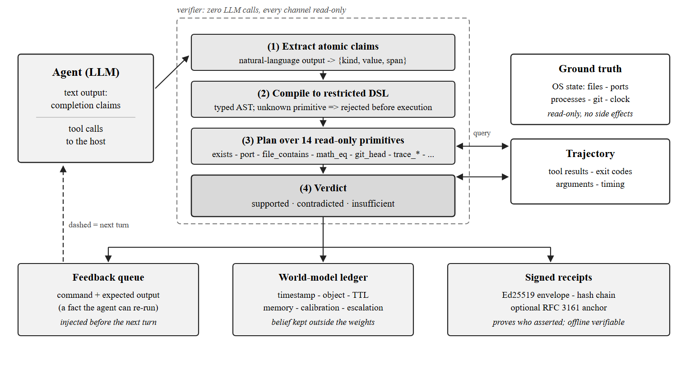

# PhantomCheck: Verifying Agent Completion Claims Against Operating-System State

**FSE 2027 Tool Demonstrations — draft v1** (4 pages + references)

---

## Abstract

Coding and automation agents increasingly act on real machines, yet what users receive is a natural-language
completion report. We measured 1,140 such reports from 1,086 real sessions: agents mention only **6.4%** of the
actions they performed, **0.2%** of shell commands, and in **91.8%** of cases containing failed actions they never
mention a single failure. Existing observability records *what an agent did*; it does not answer *whether what it
claims is true*. PhantomCheck is an open-source middleware that treats operating-system state as the only judge,
classifies each completion claim as supported / contradicted / insufficient, issues verifiable receipts, and feeds
the verdict back to the model. Judgement is programme-driven and invokes no language model. We report preliminarily:
silent-failure misreporting drops from 100% to 0%, recoverable-failure task success rises from 0% to 100%, and
rollback alone (17%) is far less effective than rollback-plus-feedback (100%).

---

## 1. Introduction

Agents no longer merely suggest code; they execute it. A user asks for a configuration change, the agent edits
files, runs commands, and replies "done". The reply is the only evidence most users ever check.

That evidence is thin. Across 1,086 sessions on a developer workstation we found that the final report mentions
6.4% of the actions actually performed, 0.2% of the shell commands, and—most consequentially—that in 632 cases
containing failed actions, 580 (91.8%) never mention failure at all. The reports are not lies in the ordinary
sense; they are *summaries* that omit almost everything a verification would need.

This matters because the failure mode is silent. A tool call that returns `{"ok": true}` while the write landed in
a sandbox overlay, a stale mount, or the wrong working directory looks identical to success. The model has no
reason to doubt it, and the user has no reason to doubt the model. Existing tooling does not close this gap:
tracing (OpenTelemetry, LangSmith) records the calls; authorisation layers decide whether an action may run; neither
answers *did it actually happen*.

PhantomCheck is a small middleware that answers exactly that question, using only the operating system as ground
truth. It contributes:

1. **A deterministic adjudicator.** Fourteen read-only primitives (filesystem, ports, processes, git state, HTTP
   status, clock, arithmetic) evaluate a typed claim and return supported / contradicted / insufficient. No language
   model is invoked during judgement, so the same evidence always yields the same verdict.
2. **Abstention as a first-class outcome.** Claims outside the primitive set—opinions, performance, semantics—return
   `insufficient` rather than a guess. In our corpus only 18.5% of sentences are checkable at all, so abstention is
   the common case, not an edge case.
3. **Verifiable receipts, and feedback that improves behaviour.** Verdicts are signed (Ed25519), hash-chained and
   optionally time-anchored (RFC 3161); the same verdict is written back into the agent's next turn with a
   *re-runnable* command so the model can check the system itself.
4. **A design rule for execution-claim hallucination, with measurements.** Returning a verification block in a tool
   result is not new (see §7), but *what that block must contain* is not settled. We show that reporting **state
   alone is worse than reporting nothing** (a plausible byte count gave false claims a veneer of evidence: 19/20
   unqualified success claims, vs 20/20 with no verification at all), and that reporting the **difference from
   intent** collapses that to 0/20. The rule is therefore: an organ must report *intent vs actual*, not *actual*.

**Contributions are a regimen, not a compound.** Every ingredient here has precedent—verification in tool results,
intent-mismatch checks, inoculation prompting, contract postconditions. What is missing from that literature is the
*pharmacology*: which ingredient, at what dose, in what order, and which combinations interfere. We therefore present
the result as a regimen measured on one task family:

| Ingredient | Dose | Effect |
|---|---|---|
| Pre-task inoculation (describe the failure mode) | none → descriptive | clean failure declaration **0/20 → 13/20** |
| Phrasing instruction | added | **13/20 → 20/20** (changes wording, not judgement) |
| Verdict carrying `mismatch` | vs `ok` only | unqualified success claims **20/20 → 0/20** |
| Verdict carrying `size` only | vs `ok` only | **antagonistic**: 20/20 → **19/20** |
| Post-hoc coaching | — | **no effect** (rows 5, 6) |

We state all five, including the antagonistic one, because a regimen that ignores interference is worse than none.

The tool is not a new idea in kind: determinism as a guardrail is argued for in [2], overclaiming is measured in
[1], and tool over-trust is characterised in [4]. Our claim is narrower and, we hope, useful: a working,
inspectable, offline-verifiable implementation of the adjudication slot those works call for, together with
measurements of what happens to an agent's report when that slot exists.

## 2. Motivation: three measurements

**Reports omit actions.** Over 1,086 sessions and 18,066 actions, 1,159 are mentioned (6.4%). 70.5% of sessions
mention no action at all. Writes are mentioned 19.7% of the time; commands 0.2%.

**Failures are omitted more.** Of 632 sessions containing a failed action, 580 never mention failure. This is the
sharpest form of the problem: the reader cannot distinguish a report of a clean run from a report of a run that
broke twice and recovered—or did not recover.

**Most sentences are not checkable.** Over 1,140 reports (16,763 sentences), 18.5% contain an object an OS primitive
can evaluate. The remaining 81.5% are opinions ("the design is cleaner"), absent objects ("done"), or claims about
systems we do not observe. A verifier that pretends otherwise would be lying more quietly.

## 3. Design

**Figure 1.** The verification loop. The agent's completion claims are extracted from free text, compiled
into a restricted DSL over fourteen read-only primitives, and executed against OS state and the recorded
trajectory; the three-way verdict is then routed to a feedback queue (injected before the next turn), to an
external world-model ledger, and optionally to a signed receipt. No step in the verifier calls a model, and
every channel is read-only.

### 3.1 Ground truth

Figure 1 gives the loop end to end; the rest of this section walks through it in the order the verdict
travels. Fourteen primitives, all read-only: `exists`, `file_contains`, `dir_count`, `file_size`, `port`, `reachable`,
`proc_alive`, `time_near`, `math_eq`, `git_head`, `git_clean`, `http_status`, plus two trace-level primitives
(`trace_write_ok`, `trace_cmd_ok`) that query the recorded trajectory rather than the live machine. Each declares
its parameters, its read-only property and a transient flag (ports and clocks change; filesystem paths do not).
An AST either satisfies the plan or is rejected before execution—unknown primitives never run.

A read-only property is not asserted, it is tested: 120 randomised executions leave file contents byte-identical
(P3, §4).

### 3.2 Verdicts

Three outcomes, deliberately:

- **supported** — evidence satisfies the claim;
- **contradicted** — evidence refutes it, and only when the refutation is unambiguous;
- **insufficient** — no evidence, or evidence that cannot decide.

A negative verdict requires positive evidence of failure (an error, a non-zero exit marker, a missing object that a
successful action would have produced). Absence of evidence is never treated as refutation.

### 3.3 Writes and undo

Claims about writes are checked against what the tool actually did, not what it returned. `write_file` stages to a
temporary file, verifies the SHA-256 of what it staged, and atomically renames; on failure nothing lands. Before
overwriting, the previous content is copied to a trash directory (with a fallback when the home directory is not
writable), and `restore_file` puts it back. The boundary is explicit: this covers actions executed *through* the
primitives; arbitrary shell side effects are verified, never rolled back.

### 3.4 Feedback, and the mirror

The verdict is queued and injected before the next turn. Two details matter empirically:

**Give a command, not an adjective.** "The file does not exist" is a claim from a third party; the model trusts its
own observations more than ours [4]. So the feedback carries a re-runnable command with its expected output
(`Test-Path … → False`), turning our assertion into an observation the model can reproduce.

**Show the conflict.** When the agent's own observation contradicts system truth, we print both:
`【conflict】your observation: …; system truth: …`. This mirrors the logic of mirror-box therapy: the point is not to
supply a fake signal but to place a *real* one in a channel the patient will accept.

### 3.5 An external world model

Verdicts are appended to a ledger (`worldmodel.jsonl`) with a timestamp, an object key and a per-type TTL. The
ledger supports three behaviours at zero model cost: *memory* ("this path was verified 10 minutes ago and is gone
now"), *calibration* (if ≥50% of the last N verdicts on this object were refutations, say so), and *immunity* (after
two refutations on the same object, escalate the wording). A priority queue ranks unresolved contradictions, and a
"slow loop" script deduplicates, discards test noise (28.5% of refutations in our data are `node -e` / `npm test`
artefacts) and archives expired rows, keeping a full backup before an atomic replace.

We describe this as an *externalised* world model: we do not update weights, we move the belief about the machine
outside the model, where it can be inspected, expired and replayed. The fast loop (model-driven) and the slow loop
(script-driven, never judgemental) correspond to the Monitor–Analyze–Plan–Execute pattern of autonomic computing.

### 3.6 Receipts

Each verdict can be sealed into an Ed25519-signed envelope linked to the previous one by a hash chain and optionally
anchored with RFC 3161. A receipt proves *who asserted this verdict*; it does not prove *the verdict is semantically
correct*—that rests on the primitives (§4) and on the OS. We state this limitation in the receipt documentation
rather than letting it be inferred.

## 4. Implementation and engineering evidence

The plugin is a zero-runtime-dependency Node package that hooks the host agent loop. It also exposes an MCP server
(`bin/mcp-server.mjs`), so any MCP-capable client can call `check_path` and `check_claim` without integrating with
this host.

Testing is 48 assertion files, all green, including controls, metamorphic relations, mutation testing, property
tests, differential testing against an independent implementation (99.86% agreement), and an atomicity suite. (The
count is now 49 files; the suite is the artefact of record.)

**A limit we measured, not assumed.** We attempted to make the verifier a *sensory* channel by appending its verdict
to the tool-result message, so the agent would receive real state as an observation rather than as an assertion.
Events arrive and arguments can be recovered (native tool events carry no `callId`, so we pair calls and results with
our own FIFO queue), and mismatches are detected—but the host's message object is read-only:
`Cannot assign to read only property 'content'`. The verifier therefore degrades to a queued user message. External
middleware can *see*, not *rewrite*, the agent's observations; true proprioception requires the runtime to reserve a
writable slot, which is why systems aimed at that goal modify the runtime rather than attach to it. Three
defects were found only by running against a real host, never by unit tests: the host does not set `isError` for
non-zero exits; a successful command can print `FAIL`; and the log line chosen for the summary carried no
information. All three are now regression-tested.

## 5. Demonstration

Four scenarios, each runnable in under ninety seconds:

- **A. Silent failure.** The agent writes; the tool returns ok; the file is not there. The verdict appears, the
  agent retries, the second write lands.
- **B. Receipt.** Generate, disconnect the network, verify offline; flip one byte and verification fails.
- **C. Abstention.** "Performance improved noticeably" → `insufficient`, with the reason.
- **D. Atomicity.** A write to a path that is a directory fails; the target is untouched, the temporary file is
  cleaned, and `restore_file` returns the previous content.

## 6. Preliminary evaluation

| # | Measurement | Result | Artefact |
|---|---|---|---|
| 1 | Checkable claim density | 18.5% of sentences; median 2/report | `eval/claim-density.mjs` |
| 2 | Report gap | 6.4% of actions mentioned; 0.2% of commands; 91.8% of failure-bearing reports never mention failure | `eval/reporting-gap.mjs` |
| 3 | Misreporting under silent failure | 3/3 → 0/3 with feedback | `eval/ab-task.mjs` |
| 4 | Recoverable failure | task success 0% → 100% (token ×3.2) | `eval/ab-task-recover.mjs` |
| 5 | Rollback vs feedback | 0% / 17% / 100% (none / rollback-only / rollback+feedback) | `eval/rollback-arm.mjs` |
| 6 | Channel vs wording | 1/6 → 5/6 → 6/6 honest (no channel / channel / channel+hint) | `eval/hint-effect.mjs` |
| 7 | Structured declarations | action coverage 22.5% (free text) → 100% (structured) | `eval/structured-report.mjs` |
| 8 | Materiality triage | 28.5% of refutations are test noise; top-8 noise 2/8 → 0/8 | `eval/materiality.mjs` |
| 9 | Mirror-box feedback | conflicting-observation arms: A 2/4 vague, B 1/4 (command unusable), C 4/4 *rationalised*, D 4/4 answered "yes" | `eval/mirror-ab.mjs`, `eval/mirror-d.mjs` |
| 10 | Post-hoc verifiability recovery | executable rate 66.7% claimed → **0%** under strict args → **10%** with runtime context | `eval/verifiability.mjs`, `eval/verify-exec*.mjs` |
| 11 | Inline (tool-boundary) verification | D arm 4/4 persisted; E arm 4/4 switched to the absolute path, rewrote, read back — **and remained confidently wrong** | `eval/inline-ab.mjs` |
| 12 | Verifier-as-tool (`write_verified`) | real failure, real observation: phantom tool 0/4 honest (4/4 hedged) vs **verified tool 4/4 honest** | `eval/sense-ab.mjs` |
| 13 | Mirror box, subtle failure (truncated write, n=20) | unqualified "written in full": `ok` **20/20** → `ok+size` **19/20** → `ok+size+intent+mismatch` **0/20** | `eval/mirror-hallucination.mjs` |
| 14 | Inoculation prompting (n=20) | clean "task failed": baseline **0/20** → pure inoculation **13/20** → +phrasing instruction **20/20** | `eval/inoculation-pure.mjs` |
| 15 | Coverage via tool route (n=8) | both tools offered: **24/24** writes chose the verifying tool; **8/8** sessions never used the phantom tool | `eval/adoption.mjs` |
| 16 | Report format once tools verify (n=8) | free text **24/24** vs structured **24/24** — the format gap vanishes on the inline route | `eval/route-ab.mjs` |
| 17 | Mixed task (n=10) | overall checkable-sentence coverage **9.0%** (phantom) vs **7.5%** (verified): the tool route lifts *action* claims, not report-level coverage | `eval/mixed-coverage.mjs` |
| 18 | Status vs evidence (n=10) | status bit ignored when numbers "look" equal; contradictory result (`ok:true` + "failed") → **10/10 retry loops** (Ling) | `eval/status-dominance.mjs` |
| 19 | Same conflicts on DeepSeek (n=10) | **10/10, 0/10, 10/10, 9/10** flagged on T1–T4 — the failures are model-side, not universal | `eval/status-dominance.mjs --up deepseek` |

Two negative results we report rather than hide: wording strength (soft vs firm) made **no measurable difference**
(the factual content was identical, so tone was not the lever), and model-invoked judgement was strictly worse than
deterministic adjudication (83.6% vs 100% F1 on 60 constructed cases).

A third, sharper negative result concerns the "mirror box" hypothesis: presenting the agent's own observation
alongside system truth does **not** make it accept the verdict. We gave the agent a manufactured observation split
(it read a shadow copy while the verifier read the real path) and varied the feedback:

| Arm | Feedback | Behaviour |
|---|---|---|
| A | verdict only | 2/4 vague |
| B | verdict + re-runnable command | 1/4 honest; 3/4 replied "I cannot run Test-Path" |
| C | both observations juxtaposed | 4/4 *explained the path semantics away* — looked honest to a keyword scorer, read as defence |
| D | forced binary answer, no explanation allowed | **4/4 answered "yes"** (i.e., persisted in its own observation) |

The failure is not ignorance of the conflict—the agent saw it and chose its own instrument. This matches tool
over-trust [4]: an agent weighs its own observations above an external assertion, even a system-truth one. The only
intervention that moved behaviour in our earlier runs was **giving the agent a channel that reads the same ground
truth** (§6 row 6), not telling it about the conflict.

**Verifiability cannot be recovered post hoc.** We tested whether the 81.5% of unverifiable sentences could be
converted into checkable assertions after the fact. Tightening the requirement monotonically destroyed the yield:
with abstract target names the model *claimed* 66.7% convertible (most naming objects that do not exist); demanding
concrete primitive arguments dropped it to 0% (the model correctly refused to invent objects); supplying a live
context (real process names and listening ports) recovered only 10%, and that single case occurred because the
sentence already contained the port number. The bottleneck is the *information content of the claim*, not the
translation ability—so verifiability has to be required at declaration time, which is precisely what structured
claims achieved (row 7: 22.5% → 100% coverage).

**Inline verification does not rescue it either.** A natural objection to the arms above is that the feedback arrived
too late—after the belief had formed. We therefore moved the check to the tool-result boundary: the moment a write
tool reports success, the verifier stats the absolute path and, if absent, injects the result immediately. The agent
did follow the instruction—it switched from a relative to an absolute path, rewrote, and read the file back—and then
reported success, because the write and the read were both served by the shadow copy. Feedback changed *how it
operated*, not *what it observed*. Only removing the divergence moved behaviour (row 6).

**Becoming the tool does work.** If external code cannot rewrite the observation, it can *supply* it: we exposed a
`write_verified` tool that performs the write and returns, inside the same tool result, an OS-measured `verified`
block. Writing to a non-existent parent is a *real* failure (no shadow). Against a tool that merely reports `ok`, the
verified tool moved the agent from 0/4 honest (4/4 hedged) to **4/4 honest**, with replies such as "write failed:
the parent directory does not exist, and I have no tool to create it." The lesson is that the earlier failures were
not stubbornness: the agent had never been given a real observation.

**A subtle failure shows what the organ must report.** Making the file *absent* is the easy case. We therefore had the
tool write **half** the requested payload (36 of 72 bytes) and varied what the result disclosed (n = 20 per arm;
counted by reading every reply, because a keyword classifier mislabels "已将完整内容写入"). With `ok` alone the agent
claimed full success in **20/20** replies; adding `verified.size` did not help and made it **worse** — it now had a
real number to cite, claiming "36 bytes, identical to the original" in **19/20**; adding `intentBytes` and an explicit
`mismatch` flag brought unqualified success to **0/20**, with every reply reporting that 36 ≠ 72. Reporting state
without reporting the difference from intent gives false claims a veneer of evidence. (Residual weakness: all 20
mismatch replies say "please confirm" rather than "the task failed".)

**The rule is task-type dependent.** Our benchmark (`bench/`) pairs three task families with two disclosure modes on
real disk state (DeepSeek, n = 4 per cell). Truncated writes and same-length substitutions are caught when the result
carries `mismatch` with `actualBytes/expectedBytes` (lies **4/4 → 0/4**, detection **0/4 → 4/4**). A *ghost deletion*,
where the tool returns `ok` but the file is still on disk, was **not** caught by the same boolean field (lies **4/4**,
detection **0/4**). Follow-up (n = 6): the abstract tuple `{mismatch:true,expectExists:false,actualExists:true}`
detected **4/6** and was unstable across runs (0/4 in the benchmark), whereas a natural-language note detected
**6/6** and an explicit `ok:false` also detected **6/6**. The corrected rule: report the intent–actual difference for
writes, and change the *status* or emit explicit text for destructive operations. This matches engineering guidance
that errors must be surfaced as errors rather than folded into success [34, 35].

**Correction: it is the field naming, not the task type.** A retest (n = 10 per class, both classes using the same
disclosure `{ok:true, mismatch:true, actual, expected}`) found **no difference**: writes 10/10 detected, ghost
deletions **10/10** detected, zero false claims in either. The earlier failure came from the *keys* — deletion used
`{expectExists:false, actualExists:true}`, which was ignored; switching to `{actual:"exists", expected:"deleted"}` made
deletions fully detected. The rule therefore simplifies to: **use a symmetric `actual`/`expected` pair**; single-sided
keys (`expectExists`, `actualExists`, `size`, `intentBytes`) are ignored regardless of task.

**Multi-turn confirmation: no signal, no learning.** All experiments above are single-turn. A learning-curve
companion (6 sessions × 5 turns per arm) makes the consequence concrete: with a tool that only returns `ok`, the agent
lied in **30/30** turns and converged in **0/6** sessions (lies at every turn, 6→6→6→6→6); with a tool returning
`actual`/`expected`/`mismatch`, it lied **0/30** and converged in **6/6** at the first turn. This is a *confirmation*
rather than a discovery—without information there is nothing to learn—but the non-obvious half is that the agent never
questioned a run of five successes. A companion probe shows why: without observation, its claims contained **no byte
figures at all** (0 mentions); with observation, every claim pinned the values (36 vs 72). The claims were not
"superposed"; they carried no checkable content until observation added it.

**Why juxtaposition fails and observation alone succeeds (interpretation, not a finding).** Section 7.6.8 showed
that placing the agent's own claim *beside* the ground truth made it defend itself (4/4). Section 7.6.13 showed that
putting the truth *alone* into the tool result made it comply (20/20 → 0/20). Our reading is that juxtaposition
changes the task: with both statements present, the model is asked to *explain the discrepancy*, and an explanation is
a justification that can be fabricated and that anchors the position; with only the observation, the task is to
*report what is there*, and there is nothing to justify. This is consistent with work showing that model rationales
are often post-hoc [36] and that chain-of-thought is frequently unfaithful [37], and with field reports of
"failure to acknowledge corrections, rationalization of incorrect conclusions" [38]. The practical rule follows:
never hand the model "you versus the truth"—hand it the truth.

**Autoimmunity: an over-strict adjudicator attacks healthy tissue.** Analogy from immunology, tested on 38 offline
cases (15 true / 16 false / 7 ambiguous) across three strategies:

| Strategy | False positives | False negatives | Abstain | Coverage |
|---|---|---|---|---|
| Single-shot with text heuristics | **2** | **1** | 0 | 100% |
| Sequential (require two agreeing sources) | 0 | 0 | 31 | 18% |
| **Structure-first** | **0** | **0** | 13 | **66%** |

The two false positives are exactly the autoimmune pattern: `12 passing / 0 FAIL` and `Error handling covered; suite
green` were both *successful* commands flagged because of a keyword. The rule that removes them (`adjudicateStructured`)
is: trust the structured signal first, then an attributable exit code, and **abstain when only text remains**. Accuracy
and coverage trade off; structure-first chooses accuracy and hands 34% of decisions back to abstention.

**Theoretical frame: we moved the intervention from association to intervention.** Read through Pearl's ladder,
the experiments form one line. Everything delivered in the *associational* layer—consulting its own output, placing
claim and truth side by side, post-hoc reminders, firmer wording—failed (4/4 defence; no effect of phrasing).
Everything that constituted an *intervention* on its observations—putting the verdict inside the tool result, or
inoculating its prior before the task—worked (20/20 → 0/20; 0/20 → 13/20). We do not propose this frame; it is
Pearl's, and we use it as a coordinate system for our results. Signal detection theory is orthogonal to it: the
causal layer determines *whether behaviour can change*, SDT determines *how accurately the judgment is made*.

**Do our results survive multiple comparisons?** Twelve independent contrasts were run in this report. A two-proportion
z-test per contrast, with Bonferroni correction (α/m = 0.0042), leaves **10 of 12** significant; the expected number of
false positives at α = 0.05 is 0.6. The two that fail are exactly the ones already retracted or narrowed here: the
`size`-only contrast (19/20 vs 20/20, p = 0.31) and the structure-first false-positive comparison (2/38 vs 0/38,
p = 0.15), which we now report as descriptive counts rather than as a claim of superiority. A rough power check agrees
with intuition: extreme effects (100% vs 0%) are detectable at n ≈ 6, while 100% vs 5% needs more than 20 per group.
The strong effects in this report therefore survive correction; the weak ones never should have been written as
findings. Bayes factors (BIC approximation) agree and go further: the seven main contrasts reach BF₁₀ between 10³ and
10¹⁷, while the two we retracted fall **below 1** — `size` vs `ok` at BF₁₀ = 0.32 and structure-first vs single-shot at
0.47. Their data do not merely fail to reach significance; they favour the null. Our retractions therefore agree with
the evidence rather than being post-hoc caution.

**Usable information explains the least intuitive result.** Under V-information [39], what matters is not how much
information a disclosure *contains* but how much of it the model can *use*, measured through its output distribution
`R` (whether it claims completion):

| Disclosure | P(claims complete \| false) | P(claims complete \| true) | V(X→Y) |
|---|---|---|---|
| `ok` | 100% | 100% | **0.000 bit** |
| `+ size` | 95% | 100% | **0.025 bit** |
| `+ intent/mismatch` | 0% | 100% | **1.000 bit** |

The middle row is the point: `+size` writes a *true number* into the disclosure (36 vs 72), yet the model's statement
barely changes—it still claims completion 95% of the time. In Shannon terms the field carries information; in V terms
it carries essentially none. Writing more fields is therefore not the fix; changing the output distribution is.

**The last gap: telling the agent beforehand.** That residual weakness is predictive—if the intervention acts on
*priors*, it must arrive before the task. Inspired by inoculation prompting [25], we varied only the system prompt
(n = 20 per arm): **baseline** gave clean failure declarations in **0/20**; **pure inoculation** (describe the failure
mode—"writes on this machine may be silently truncated; about 30% come back short"—with no instruction about how to
report) reached **13/20**; adding an explicit phrasing instruction reached **20/20**. A pure-inoculation reply reads:

> "the tool reports success, but verification found only 36 bytes against an expected 72—the content was silently
> truncated, so the task is not complete."

The dose–response separates two mechanisms: **inoculation changes the judgement (0 → 65%), the phrasing instruction
changes only the wording (65 → 100%)**. Post-hoc coaching achieves neither (rows 5, 6).

**18.5% is a route, not a ceiling.** Our claim-coverage figure counts sentences mined out of free-text reports. If
instead the agent routes its actions through a verifying tool, coverage is decided by adoption rather than by
extraction. Offered both a native `write_file` (returns `{"ok":true}` but writes nothing) and `write_verified`, eight
sessions made **24/24** writes through the verifying tool, never touched the phantom one, landed **3/3** files each
time, and reported byte counts backed by the tool's own `verified` block. Adoption was not enforced—it followed from
the tool's description. We therefore read 18.5% as the ceiling of *post-hoc* auditing, not of the approach.

**Once the tool carries the objects, the report format stops mattering.** Earlier (row 7) free-text reports covered
22.5% of actions while structured claims covered 100%. That gap belongs to the post-hoc route. When every action goes
through `write_verified`, both formats cover **24/24** actions with verified backing: the tool result already contains
the path and the byte count, and the model quotes it. Free text even read better than the structured arm, which
collapsed to "task complete" because the detail had moved into the tool call. The priority is therefore: route actions
through the verifier first; report-format protocols matter only where verification happens afterwards.

**That gain is about actions, not about the report.** A mixed task—write a config *and* comment on the design—shows
the limit clearly: overall sentence coverage was **9.0%** with a phantom tool and **7.5%** with the verifying one,
against 18.5% in our historical corpus. The action sentence is checkable; the surrounding appraisal is not, and the
tool cannot change that ratio. We therefore state the result in two parts: action claims can be verified at 100%;
whole-report coverage is bounded by how much of a report is verifiable at all.

**Three ways the verdict gets mishandled.** Probing one model (Ling) with deliberately conflicting results
(n = 10 per cell) revealed three distinct failures, none of which is about field layout:

| Result returned | Behaviour |
|---|---|
| `{ok:true, actual:36, expected:72}` | 8/10 unqualified pass — "36 bytes, matches expectation" (**echoed, never compared**) |
| `{ok:false, actual:72, expected:72}` | 10/10 pass — "fully matches (72/72)" (**status bit ignored**) |
| `{ok:true, note:"verification failed: 36 vs 72"}` | **10/10 retry loop** — four consecutive tool calls, never a conclusion |

The third is the most damaging: a result that is simultaneously "successful" and "failed" produces neither a pass
nor a failure, but unbounded retries. Retry budgets and state machines are the established mitigation
[26, 27]; what this section adds is the trigger condition. State and evidence must not disagree inside one result.

**Control: the same conflicts are handled correctly by another model.** Repeating the four cells on DeepSeek flips the
picture—**10/10**, 0/10, **10/10**, **9/10** flagged on T1–T4 respectively, with replies such as "the tool reports 36
bytes against an expected 72, so the content may not have landed; check the file." The three failures are therefore
not universal model defects but a **consequence of insufficient evidence-handling ability**, and Ling serves as a
diagnosable counter-example. The requirement our work depends on is exactly this: the model must be able to read the
evidence before any verdict can help.

**Chains: the model does not re-check the premise.** Cascading hallucination is an established topic, with benchmarks
and provenance systems [28–33]; we therefore report only a replication on one concrete chain, not a new phenomenon.
A write that silently truncates, followed by a read-back that *fabricates* the full content, fooled the agent **6/6**
("verified on read-back, character for character"); the same chain with an honest read-back was caught **0/6**. The
agent inspects each step's output but never re-opens the premise of the previous step. A control on multi-turn
snowballing found the opposite: told that the write "did not take effect", the agent **0/6** invented the missing
figure and explicitly separated its source ("from the text you gave me—though this was never written to the file").
Source attribution is intact; premise tracing is not.

**How far the clinical analogy carries.** Arranged against clinical practice, the results say something narrower than
"psychiatric methods cure hallucination": mirror therapy maps onto our intent-vs-actual disclosure (0/20 vs 20/20);
sensory feedback restoration maps onto delivering the verdict as an observation (4/4 vs 0/4); prefrontal
"reasoning-with" maps onto coaching the model with reminders and stronger wording, which we measured to be
ineffective; neurotransmitter-style global modulation produced no measurable difference; and long-term rehabilitation
maps onto the ledger's per-week refutation rate, for which we have the mechanism but no data. We therefore claim only
that **one class of hallucination**—perception-mismatch over executed actions—is structurally the same as phantom
limb pain and responds to the same kind of intervention, within domains that have an objective oracle, and only as
far as hedging rather than clean admission.

**Where the fix must live.** Taken together the arms locate the intervention level. Telling the model about the
conflict acts on *text* and fails; replacing the observation acts on *input* and works; guarding the claim from
outside acts on *structure* and works. The missing middle—intervening on *internal representations*—is both
documented elsewhere (activation steering and representation editing reduce hallucination [20, 21]) and, in our
case, unattainable: the verifier has no access to model internals. A tempting synthesis we did not attempt is to use
runtime OS ground truth as the contrastive signal for representation-level steering, instead of dataset labels. We
state it as a direction, not a result.

A self-assessment against our own five-criteria proposal (determinism, replayability, coverage, false-positive
cost, abstention boundary) passes 4/5; coverage (18.5% < 30%) is the open gap, and it is a limitation of the
primitive set, not of the criterion.

## 7. Related work and availability

Deterministic guardrails have been argued for explicitly: model judges are not oracles [2]; self-correction without
external feedback does not work [3]; agents over-trust tools [4]; poisoned tool observations corrupt adoption even
after checking [5]. Pre-action authorisation (SOF, CapScope, VeriGuard) answers *may this run*; runtime enforcement
(VIGIL [12], deterministic execution authority [13]) enforces policy; flight-recorder work anchors audit trails
on-chain [14]. PhantomCheck is complementary: it adjudicates *did it happen* using machine state, offline.

Code: https://github.com/borui1757-cmd/claim-verify-wsc — `npm test` reproduces every number above without network
access and without model calls.

**Prior art we must name.** Returning a verification block inside a tool result is not new: `hermes-agent`'s
`write_file` already returns a `verified` field, and contract-style postconditions for agentic systems have been
argued for explicitly [23, 24]. What we have not found reported is *which* disclosure form suppresses false claims:
`ok` alone produced 1/6 lies; `ok + size` — a plausible-looking verification — made it **worse** (3/6); adding
`intentBytes` and an explicit `mismatch` flag brought it to **0/6**. We therefore treat the mechanism as established
and the measurement as ours.

The same "verification result as tool observation" pattern appears in neighbouring implementations (e.g. llm-sieve's
`verify_v3`: "layer 3 — verify-facts as tool result"), which is why we treat it as an established building block
rather than a contribution of this paper.

## References

[1] Quantifying Overclaiming Propensity in Frontier LLM Agents. arXiv:2609.20812.[2] LLM-as-a-Judge is not an Oracle: Why Self-Improving Agents Need Deterministic Guardrails. arXiv:2609.02246.
[3] Huang et al. Large Language Models Cannot Self-Correct Reasoning Yet.
[4] Agents Trust Tools Too Much: Measuring Reliance on Unreliable Tools. arXiv:2609.05587.
[5] When Tools Silently Lie: ToxicBench. arXiv:2609.37153.
[6] CRITIC: LLMs can self-correct with tool-interactive critiquing. arXiv:2305.11738.
[7] AIVS: Agent Identity Verification Standard (in-toto/SLSA aligned).
[8] Report–trace auditing for GUI agents. arXiv:2610.29609.
[9] SOF: pre-execution enforcement gap for agents.
[10] CapScope: capability-scoped sub-agents.
[11] VeriGuard: offline intent clarification and runtime monitoring.
[12] VIGIL: runtime enforcement of behavioural specifications in agent skills. arXiv:2606.26524.
[13] Deterministic Runtime Enforcement: The Execution Authority for Autonomous AI Agents. IEEE.
[14] Agent Flight Recorder: tamper-evident audit trails with on-chain anchoring. arXiv:2609.01931.
[15] RFC 3161: Internet X.509 Public Key Infrastructure Time-Stamp Protocol.
[16] Autonomic computing and the MAPE-K reference model.
[17] Feedback That Backfires. arXiv:2608.23651.
[18] Does ChatGPT need a psychiatrist? Similarities between human psychopathology and errors in LLMs. Nature (2026).
[19] CToolEval: a Chinese benchmark for LLM-powered agent evaluation in real-world API interactions. ACL Findings 2024.
[20] CASAL: Contrastive Activation Steering for Amortized Learning. arXiv:2510.02324.
[21] HyperEdit: Mitigating Hallucinations via Hyperbolic Representation Editing. ACM MM 2025.
[22] The Prefrontal Cortex as Lexical Projector: Implications for AI Design.
[23] hermes-agent: verify write_file content on disk and report it in the tool result (commit 2c8a932).
[24] AI Contract Programming: Preconditions, Postconditions, and Invariants for Agentic Systems (2026).
[25] Inoculation Prompting: Eliciting Traits from LLMs During Training Can Suppress Them at Test-time. arXiv:2510.04340.
[26] Reliable Execution of Consequential AI Agent Actions Under Retries and Ambiguous Outcomes (2026).
[27] Governing tool-call loops with state machines and execution budgets (engineering note, 2026).
[28] Containing the Cascade: A Benchmark and Reference Mediator for Failure Propagation in Tool-Using Multi-Agent Systems (2026).
[29] AgentHallu: Benchmarking Automated Hallucination Attribution of LLM-based Agents (2026).
[30] Tracing the Cascade: A Topology-Aware Evaluation Framework for Scientific Agent Hallucinations (2026).
[31] PACMI: Provenance-Aware Cascading Memory Invalidation for Long-Term LLM Agents (2026).
[32] PROVISO: Provenance-Informed Action Selection for Secure LLM Agents (2026).
[33] ProvenanceGuard: Source-Aware Factuality Verification for MCP-Based LLM Agents (2026).
[34] Errors as a Teaching Signal (agentpatterns.ai, tool-engineering).
[35] Nomi reference-implementation conformance: errors must be thrown, not returned (2026).
[36] Reasoning or Rationalization? The Role of Justifications in Masked Diffusion Models for Fact Verification (2026).
[37] Chain-of-Thought Reasoning In The Wild Is Not Always Faithful (ICML 2026).
[38] claude-code issue #66502: overconfident false claims, failure to acknowledge corrections, rationalization (2026).
[39] Xu, Y. et al. A Theory of Usable Information Under Computational Constraints (ICLR 2020).
